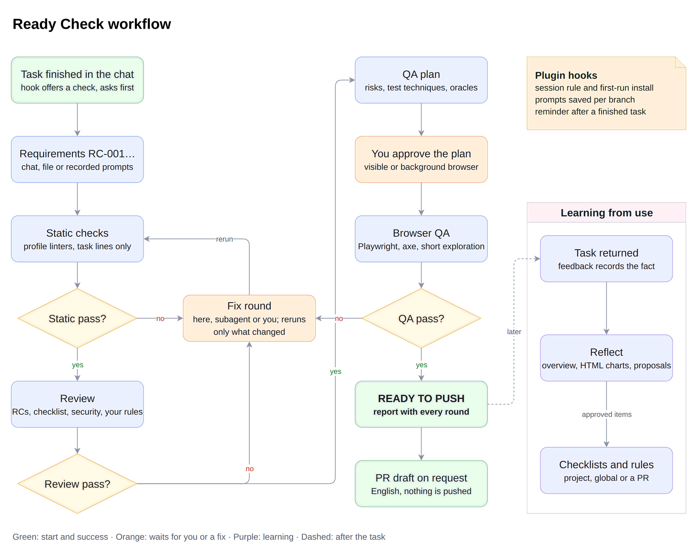

<p align="center">
  
</p>

# Ready Check · Review & QA

A plugin for Cursor, Claude Code and Codex that checks whether a task is ready to push: the code meets the task's
requirements, passes the project's checkers, follows the framework's practices, is safe, and works in a browser.
It runs inside the chat you already use, with the agent you already have. The checks are not invented here: each
stage packages established engineering and testing practice into an agent skill (see [Foundations](#foundations)).

## How it works



The diagram source is [assets/workflow.drawio](assets/workflow.drawio); edit it in draw.io and export the PNG again.

1. **Task and requirements.** The agent takes the task from the chat, a file or the prompts Ready Check recorded
   for the branch, asks only what changes the expected result, and writes requirements `RC-001`, `RC-002`, … with
   acceptance conditions. Progress is tracked in the client's own task list and in a report.
2. **Static checks** run the framework profile's checkers on the task's lines only.
3. **Review** traces every requirement through the code, applies shared and profile checklists for the kinds of
   changes found (configuration, forms, cache, access…), checks code quality (design fit, simplicity, names,
   comments, errors, dead code), reviews tests when the change has them, confirms a bug fix removes the cause,
   and applies your own coding rules. Findings are labelled `issue (blocking)`, `suggestion`, `nitpick` or
   `question`; only issues block.
4. **QA** ranks changed areas by risk and shows the plan for approval. It verifies browser, API, CLI or
   CI and native mobile outcomes as applicable, with accessibility and exploration for browser cases.
5. **Verdict.** `READY TO PUSH` requires complete current validation and opens the delivery choice.
   Other runs report `BLOCKED`, `INCOMPLETE` or `PARTIAL CHECK COMPLETE`. Findings come with a fix offer.
   After a fix or "retest", the next round reruns only what the change can affect.

Plugin hooks do the rest without being asked: the agent offers a check after finishing a task, installs tools
after one consent, records your prompts per branch and passes your coding rules into every session.

| Skill | Claude Code / Cursor / Codex | Example request |
| --- | --- | --- |
| `check` | `/ready:check` · `/check` · `$check` | “Check this before I push.” “Run only static checks.” “Retest after the fix.” |
| `review` | `/ready:review` · `/review` · `$review` | “Use Ready Check to review these changes for correctness and security.” |
| `qa` | `/ready:qa` · `/qa` · `$qa` | “Do only CLI QA for this behavior.” “Plan browser QA for this flow.” |
| `draft` | `/ready:draft` · `/draft` · `$draft` | “Write a commit message.” “Draft the PR description.” “Generate a task comment about what I did.” |
| `setup` | `/ready:setup` · `/setup` · `$setup` | “Set up Ready Check.” “Change the profile or runner for this project.” |
| `customize` | `/ready:customize` · `/customize` · `$customize` | “Remember this coding rule for this project.” “Use my template for task comments.” |
| `feedback` | `/ready:feedback` · `/feedback` · `$feedback` | “QA returned this task. Record the reason in Ready Check.” |
| `reflect` | `/ready:reflect` · `/reflect` · `$reflect` | “Show my Ready Check stats.” “Where do my tasks get stuck before PR?” |
| `contribute` | `/ready:contribute` · `/contribute` · `$contribute` | “Prepare a contribution for this improvement to the Ready Check plugin.” |
| `uninstall` | `/ready:uninstall` · `/uninstall` · `$uninstall` | “Preview what uninstalling Ready Check would remove.” |

Ask for draft text whenever you need it, including while a task is in progress. Git and tracker actions
require a separate publication request or delivery choice.

Checks live in framework profiles. See [supported profiles](#supported-profiles) for available stacks and checkers.

## Foundations

| Stage | Built on |
| --- | --- |
| Requirements | Acceptance conditions per requirement and traceability from requirement to evidence, as in requirement-based testing |
| Static checks | The project's own linters first, then the framework's established tools: Drupal Coder (PHPCS) and phpstan-drupal; Pint and Larastan; PHP-CS-Fixer `@Symfony`, phpstan-symfony and the `bin/console` linters; Ruff, mypy, Bandit and Django system checks; gofmt, go vet, golangci-lint (staticcheck, errcheck, gosec) and govulncheck; ESLint and Stylelint for assets |
| TypeScript and YAML | [TypeScript Compiler API](https://github.com/microsoft/TypeScript/wiki/Using-the-Compiler-API) and [project references](https://www.typescriptlang.org/docs/handbook/project-references.html) for type checking, [typescript-eslint](https://typescript-eslint.io/getting-started/) for linting, and [yamllint](https://yamllint.readthedocs.io/en/stable/configuration.html) for plain YAML |
| Infrastructure checks | [actionlint](https://github.com/rhysd/actionlint/blob/main/docs/usage.md) for GitHub Actions, [Compose config](https://docs.docker.com/reference/cli/docker/compose/config/), [DDEV utilities](https://docs.ddev.com/en/stable/users/usage/commands/) and [Nginx configuration testing](https://nginx.org/en/docs/switches.html). [GitLab CI Lint](https://docs.gitlab.com/ci/yaml/lint/) validates the effective pipeline and its includes on GitLab. |
| Flutter checks | [Flutter CLI](https://docs.flutter.dev/reference/flutter-cli) for analysis and project tests, and [Dart format](https://dart.dev/tools/dart-format) for formatting checks |
| Review | [Google code review guide](https://google.github.io/eng-practices/review/reviewer/looking-for.html) (functionality, design, complexity, tests, naming, comments), [Conventional Comments](https://conventionalcomments.org/) (finding labels), [ub-mode](https://github.com/unclebob/ub-mode) (fix the root cause, tests that test behavior, one source of truth), [OWASP Code Review Guide](https://owasp.org/www-project-code-review-guide/) (trace input to access, validation, storage and output), framework security guides ([OWASP Laravel](https://cheatsheetseries.owasp.org/cheatsheets/Laravel_Cheat_Sheet.html), [OWASP Symfony](https://cheatsheetseries.owasp.org/cheatsheets/Symfony_Cheat_Sheet.html), [OWASP Django](https://cheatsheetseries.owasp.org/cheatsheets/Django_Security_Cheat_Sheet.html), [Django deployment checklist](https://docs.djangoproject.com/en/5.2/howto/deployment/checklist/), [Go security best practices](https://go.dev/doc/security/best-practices)), version-matched Drupal documentation ([updating configuration](https://www.drupal.org/docs/drupal-apis/update-api/updating-configuration), [render cacheability](https://www.drupal.org/docs/drupal-apis/render-api/cacheability-of-render-arrays), [writing secure code](https://www.drupal.org/docs/administering-a-drupal-site/security-in-drupal/writing-secure-code-for-drupal)); deterministic checks run before the model, and every blocking finding needs file, line and cause |
| Shared review checklists | [OWASP ASVS](https://asvs.owasp.org/) for web and API security, [Parallel Change](https://martinfowler.com/bliki/ParallelChange.html) for staged migrations, and [AWS Builders' Library](https://aws.amazon.com/builders-library/making-retries-safe-with-idempotent-APIs/) for idempotent retries |
| QA design | ISTQB / ISO/IEC/IEEE 29119-4 techniques: equivalence partitioning, boundary values, state transitions, decision tables, error guessing; risk-based testing (likelihood × impact) |
| QA oracles and exploration | HICCUPPS consistency oracles ([Bolton](https://developsense.com/resource/Oracles.pdf)), SFDPOT and session-based exploratory testing with charters |
| Bug reports | RIMGEA (Kaner's bug advocacy): replicate, isolate, maximize, generalize, externalize; steps, expected and actual result, severity, evidence |
| Browser automation | [Playwright best practices](https://playwright.dev/docs/best-practices): user-facing locators, web-first waits, isolated sessions; official Playwright CLI and MCP |
| Automated test changes | [ISTQB CTFL v4.0.1](https://istqb.org/?sdm_process_download=1&download_id=3345) (§1.4.4 and §4.2) for reviewing requirements coverage against existing assertions. [Playwright Test](https://playwright.dev/docs/test-cli) and [Cypress best practices](https://docs.cypress.io/app/core-concepts/best-practices) for browser test review and targeted runs. |
| Web platform review | [Modern Web Guidance](https://developer.chrome.com/docs/modern-web-guidance) and [Baseline](https://web.dev/baseline) for browser compatibility, progressive enhancement and fallback scenarios |
| Technical QA | Project tests and fixtures, [OpenAPI](https://spec.openapis.org/oas/latest.html) for API contracts, and [CI run evidence](skills/qa/references/technical-qa.md#ci-and-artifacts) tied to the tested revision |
| Design and native QA | [Figma Dev Mode and MCP](https://developers.figma.com/docs/figma-mcp-server/tools-and-prompts/) for agreed design references, existing [Flutter integration tests](https://docs.flutter.dev/cookbook/testing/integration/introduction), [Maestro](https://docs.maestro.dev/get-started/supported-platform/flutter) for device flows, and [OWASP MASVS](https://mas.owasp.org/MASVS/) for mobile security |
| Learning from use | Cursor's [`/reflect`](https://github.com/cursor/plugins/blob/main/pstack/skills/reflect/SKILL.md) and [Continual Learning](https://github.com/cursor/plugins/tree/main/continual-learning), [CodeRabbit Learnings](https://www.coderabbit.ai/blog/context-engineering-ai-code-reviews): proposals backed by evidence, applied only after approval |
| Accessibility | [axe-core](https://github.com/dequelabs/axe-core) on changed pages plus manual keyboard and focus checks, since automated rules find only part of WCAG issues ([Deque coverage study](https://www.deque.com/blog/automated-testing-study-identifies-57-percent-of-digital-accessibility-issues)) |

## Install

Ready Check lives in the [Keledones](https://github.com/rchehd/keledones-plugins) plugin catalog (`plugins/ready-check`).

Claude Code:

```sh
claude plugin marketplace add rchehd/keledones-plugins
claude plugin install ready@keledones
```

Codex:

```sh
codex plugin marketplace add rchehd/keledones-plugins
codex plugin add ready@keledones
```

Then open `/hooks` in Codex and trust the plugin's three hooks; Codex runs them only after that and may ask
again after each plugin update.

Cursor: **Customize → From GitHub Repository** with `rchehd/keledones-plugins`, or a team admin adds it under
**Dashboard → Plugins & MCPs → Add Marketplace → Import from Repo**.

For development, add the local Keledones checkout path. To install Ready Check on its own, follow the
[individual plugin instructions](https://github.com/rchehd/keledones-plugins#install-an-individual-plugin).

## Use

Open the application you want to check and start a chat. On the first session in a project the agent shows what
Ready Check detected (for example "Drupal 11, DDEV" or "Laravel, Compose") and asks once whether to install Playwright, Chromium and the
framework checkers. Confirm or correct the project type; on yes the tools install in the chat and the agent ends
with "Ready Check is ready". Downloads are agreed once per machine, the project type once per project. On no,
nothing is downloaded and the question is not repeated; review, reminders and task records still work.

After you finish a task that changed the project, the agent offers checks based on the changed behavior,
paths and applicable profiles. A workflow change can get CI QA, while a changed web flow and API can get both
Playwright and API QA. Choose all applicable checks, a subset or skip. You can also start a check yourself
with the commands in [How it works](#how-it-works).

**Test-only tasks.** Ready Check reviews the coverage, assertions and fixtures of added or changed tests.
QA runs the selected cases with the project's own runner, such as Playwright Test or Cypress, and records
which cases executed. Use the project's configured environment and its installed test tools. See the
[test review checklist](skills/review/references/automated-tests.md) and
[project test runner guidance](skills/qa/references/project-tests.md).

Ready Check works through plugin hooks and does not write `AGENTS.md`, `CLAUDE.md` or project MCP configs. In
Codex, trust the plugin's hooks once in `/hooks`. Cursor gets the rule at session start but no end-of-turn
reminder.

**QA.** The agent ranks changed areas by risk, designs cases with standard techniques (equivalence classes,
boundary values, state transitions, decision tables), shows the plan for approval, then runs it. Browser cases
use Playwright, axe-core and manual keyboard and focus checks. API and CLI cases use project tools or direct
tests, and CI cases inspect the matching run, job and artifact. Native mobile cases use existing device tests
or Maestro on the provisioned target. When a task has an agreed Figma reference, QA compares the matching
viewport, variant and state against that reference. All results go into the same report. It stops for
you only when the task is unclear, for plan approval, for a login, when it is unsure whether something is a bug,
and when it finds one. For bugs it offers: fix in this session, fix with a subagent (where the client supports
it), or you fix it. After a fix, or when you say "retest", the next round reruns only what the change can
affect: static checks, review of changed code and its callers, failed and related QA cases and each RC's main
flow; shared-code changes or "full recheck" run everything.

**Browser.** Browser scenarios run in a **visible** browser (bundled Playwright MCP; you watch and can log in yourself) or in
the **background** (Playwright CLI). The agent asks for a mode unless you set a default:
`config set browser visible|background`. In Drupal the agent logs in through `drush uli`, in Symfony through `login_link` when configured, elsewhere
with a local test user it creates and keeps in `.ai/ready-check/qa-accounts.json`; it never asks for or types
real credentials. A visible browser needs a graphical session.

**Language.** The agent talks in your language; reports, QA plans and handoffs are written in English unless you
choose another language at first run or with `config set artifactLanguage Ukrainian`. Commit messages and
PR/MR text stay in English.

**Delivery.** If selected checks pass, choose to see the English commit message and PR/MR text in chat or
open a PR/MR. A partial run also offers the outstanding checks and keeps its partial verdict if you proceed
to delivery. To create a PR/MR, your client needs an authenticated `gh`, `glab` or connector. The agent shows
the branches and any required commit or push before you choose. After delivery it offers a first-person
task-comment draft in the current chat's language.

**Draft templates.** Set `commitTemplate`, `pullRequestTemplate` and `taskCommentTemplate` to your own files.
Project and global overrides are available in every client. See the
[template settings](dependencies/SETUP.md#commit-pr-and-task-comment-templates).

**Task memory.** Each prompt you send, and each answer you pick in the agent's questions, is saved with branch,
commit and time in `.ai/ready-check/tasks/<branch>/` (git-excluded, cut at 20 KB, kept 30 days). When the task is not in the chat, `check` proposes it from these
records and asks you to confirm. Turn off with `config set captureTasks false`.

**Coding rules.** Add your own rules, for example "Prefer switch over long if/elseif chains" or "Flag comments
longer than two lines". The session hook gives them to the agent in every chat, and the review checks changed code
against them. A rule that starts with `MUST:` blocks the review; others are recommendations. Sources:

- Claude Code: the plugin's **Coding rules** setting (shown when the plugin is enabled); Cursor: the plugin
  variable `READY_CHECK_RULES`, one rule per line.
- Any client: tell the agent "remember the rule …" (the `customize` skill), saved globally or for the project.

Settings and commands: [setup guide](dependencies/SETUP.md).

## Customize and improve

Ready Check changes its behavior through files you own, never by editing the plugin, so plugin updates keep them.

```text
<data folder>/                        global: all your projects (~/.local/share/ready-check on Linux)
├── rules.md
└── extensions/<profile>/review.md, qa.md

<repo>/.ai/ready-check/                project: git-excluded by default
├── rules.md
├── extensions/<profile>/review.md, qa.md
├── feedback.jsonl, reports/, tasks/, settings.json   always local
```

On upgrade, Ready Check moves local entries from `ai/ready-check/` into `.ai/ready-check/` automatically.
Git-tracked files stay in place until your team moves them. Shared rules and checklists remain active alongside
new local items. Ready Check keeps legacy journals available to older clients, reads both locations without
counting entries twice, and applies task-log retention to both. Files copied across filesystems keep their legacy
copies. The active Git commit template stays at its configured path.

If the same report already exists in both folders, each copy keeps its own evidence and the report in
`.ai/ready-check/` remains active. A legacy branch-level report can coexist with dated tasks and keeps its original
`task_id`. Markdown links and JSON evidence references are updated to point to migrated evidence.

- **Rules** act in every session and in every review (`MUST:` rules block). **Extensions** add items to a section of
  the profile's review or QA checklist, for example "I. Render output, templates and cache".
- **Add or change** them with `customize`: "add a review check for forms to the project", "show my rules",
  "disable that rule". Disabling in a project also hides a global item or a client-settings rule there.
- **Share with the team:** `git add -f .ai/ready-check/rules.md .ai/ready-check/extensions` and commit; reports, task
  records, feedback and settings stay local.
- **Feedback:** when a lead or QA returns a checked task, say so ("the task was returned…"); the agent asks and
  records it with `feedback`: who, why, and whether Ready Check missed it.
- **Reflect:** "show my Ready Check stats" gives an overview of the last 10 tasks (rounds, defects, returns, typical
  errors) in the chat and an HTML report with charts in `.ai/ready-check/reflect/`. Only if you ask does it propose
  improvements; for each you choose any of: project, global, PR to Ready Check, skip.
  For a private portrait of how you give instructions, delegate and redirect agents, use the
  [Gnothi portrait](https://github.com/rchehd/keledones-plugins/tree/main/plugins/gnothi).
- **Contribute:** general improvements go to the Ready Check repository as a pull request from the
  [improvement template](templates/improvement.md), prepared by `contribute` and published only
  after your yes. No client code or data leaves your environment; see [CONTRIBUTING](CONTRIBUTING.md).

**Check a task** by describing the task or pointing to it. You can ask for all checks or only some:
static, review, or QA. To check specific commits instead of the whole branch, name them:

> /check — check commits a1b2c3d and e4f5a6b against TASK.md

The agent asks when something is unclear and pauses for your approval of the QA plan. When it finds a
problem, it asks whether to fix it or leave it to you, then rechecks after the fix. Commit and push are part
of delivery only when you select creation with those operations.

**Report:** `.ai/ready-check/reports/<branch>/report.md` at the repository root. It is git-excluded.
A later chat on the same branch continues from it. The directory name combines a readable branch slug
and a hash of its full name, so similarly named branches keep separate reports.

## Verdicts

| Verdict | Meaning |
| --- | --- |
| `READY TO PUSH` | All checks passed for the current code and every requirement is covered |
| `BLOCKED` | A confirmed problem was found |
| `INCOMPLETE` | Something is missing: an answer, a tool, access or evidence |
| `PARTIAL CHECK COMPLETE` | The selected checks passed; the others were not run |

## Supported profiles

Each profile supplies detection rules, setup, static checks, and review/QA guidance for its scope.
Shared skills load these rules from each applicable profile. Required checks run when their inputs apply;
advisory checks report findings or missing tools without blocking the static gate.

- **[Drupal 10/11](profiles/drupal/static.md)** — profile ID: `drupal`.
  - **PHPCS** — PHP coding standards; defaults to Drupal and DrupalPractice rules.
  - **PHPStan** — static PHP analysis with Drupal integration and deprecation rules.
  - **PHP/YAML syntax** — `php -l` and the Symfony YAML parser.
  - **ESLint / Stylelint** — JavaScript and CSS/SCSS checks.
  - **Twig CS Fixer** — Twig template linting, without auto-fix.
  - **Composer validate** — dependency manifest and lock-file consistency.
  - **Debug leftovers** — checks for debugging calls and statements.
  - **Git diff formatting** — whitespace/error checks.
  - **Module configuration** — checks packaged Drupal configuration for site-specific UUID/hash values.
  - **jscpd** — duplication detection; advisory.
  - **PHPMD** — code-size and unused-code checks; advisory.
  - **Composer audit** — dependency security advisories and abandoned packages; advisory.
  - **Dead-code detector** — optional PHPStan extension; disabled by default and not included in managed dependencies.

- **[Laravel 12+](profiles/laravel/static.md)** — profile ID: `laravel`; Sail, DDEV or local.
  - **Pint** `--test` (project `pint.json` wins), **PHPStan with Larastan** (default level 5), `php -l`,
    debug leftovers (`dd`, `dump`, `ray`, `var_dump`), diff, ESLint/Stylelint for Vite assets, `composer validate`.
  - Advisory: **Rector** `--dry-run` with the Laravel set, `composer audit`, jscpd, PHPMD.
- **[Symfony 7.4+](profiles/symfony/static.md)** — profile ID: `symfony`; Docker Compose, DDEV or local.
  - **PHP-CS-Fixer** `@Symfony` when the project has a config (else PHPCS PSR-12), **PHPStan with
    phpstan-symfony** (and phpstan-doctrine with Doctrine), `php -l`, `lint:container`, `lint:yaml`,
    `lint:twig`, `lint:xliff` when their inputs changed, debug leftovers, diff, `composer validate`.
  - Advisory: `doctrine:schema:validate`, `composer audit`, jscpd, PHPMD.
- **[Python](profiles/python/static.md)** (Django, FastAPI, Flask) — profile ID: `python`; project venv, uv,
  Poetry or Compose.
  - **Ruff** lint and `ruff format --check` (project config wins), **mypy** when the project configures it,
    syntax, debug leftovers (`breakpoint()`, `pdb`, `print(` in app code), diff; Django: `manage.py check` and
    `makemigrations --check --dry-run`.
  - Advisory: **Bandit**, **pip-audit**, jscpd.
- **[Go](profiles/go/static.md)** — profile ID: `go`; local or Compose.
  - **gofmt**, **go vet**, **golangci-lint** (project config wins; default enables staticcheck, errcheck,
    gosec, govet, ineffassign, unused), `go build`, debug leftovers (`spew.Dump`, `"DEBUG` prints,
    `println`), diff.
  - Advisory: **govulncheck**, jscpd.
- **[Generic](profiles/generic/static.md)** — profile ID: `generic`; any language or a mixed-language repository.
  - Git diff checks, syntax checks for Python, plain JSON, YAML and POSIX sh/Bash, and project-specific lint and test
    commands recorded by the check skill. Profile setup uses the existing tools on the selected host.
- **[TypeScript](profiles/typescript/static.md)** — profile ID: `typescript`.
  - TypeScript type checking with project configs and references, and ESLint for changed TypeScript files.
    Uses project tools and configs first. The managed fallback includes official typescript-eslint rules.
- **[DevOps](profiles/devops/static.md)** — profile ID: `devops`.
  - GitHub Actions with actionlint, Docker Compose, DDEV and Nginx validation, and GitLab YAML syntax.
    Uses installed tools. GitLab CI Lint adds provider checks for the effective pipeline and its includes.
- **[Flutter](profiles/flutter/static.md)** — profile ID: `flutter`.
  - Uses the project's Flutter SDK for analysis and the bundled Dart formatter. QA reuses the project's
    unit, widget and device tests, with Maestro for applicable native flows.

Project tools and configs take priority over pinned tools installed outside the project. Projects can use
several profiles in one directory or across application roots. When no specific profile matches, Ready Check
uses `generic`. You can also select `generic` explicitly. New profiles belong under
`profiles/<id>/` and reuse `profiles/_shared/` ([adding a
profile](dependencies/SETUP.md#adding-another-profile)).

## Configuration

The profiles you confirm at first run are stored in `.ai/ready-check/settings.json` (git-excluded) and take
precedence over the repository's optional `.ready-check.json`. To share selections with your team, use:

```json
{
  "profiles": [
    {"profile": "drupal", "runner": "ddev", "application": "."},
    {"profile": "python", "runner": "local", "application": "tools"}
  ]
}
```

`application` is relative to the repository root. `runner` can be `local`, `ddev` or `compose`.
Existing scalar `profile`, `runner` and `application` settings still define one selection. When the legacy
runner is omitted, it is detected from project markers. `LINT_SERVICE` and `LINT_CONTAINER_ROOT` pick the
Compose service and root. The `ready-check.py profiles --project <repo>` command shows selections and evidence.
Project tools and configs (`vendor/bin`, `phpcs.xml`, `phpstan.neon`, `pint.json`, `.php-cs-fixer.dist.php`,
`[tool.ruff]`, `.golangci.yml`, ESLint/Stylelint configs) take priority over the managed ones.

## Requirements

- Python 3.9+ and Git (Linux, macOS, Windows, WSL).
- Node.js 20+ and npm on the host for the browser.
- For Drupal checks: PHP 8.2+, Composer, Node.js 20+ and npm in the selected runner.
- For Laravel and Symfony checks: PHP 8.2+, Composer, Node.js 20+ and npm in the selected runner.
- For Python checks: Python 3.10+ in the runner for the managed tools; the project's own interpreter for
  Django checks.
- For Go checks: Go 1.26+ in the runner (the pinned golangci-lint needs it); Node.js 20+ for asset checks.
- For TypeScript checks: Node.js in the runner. Managed setup requires Node.js 20+ and npm.
- For YAML checks in Generic: `yamllint` in the selected runner.
- For DevOps: the tools that match the changed files, as listed in the [DevOps profile](profiles/devops/static.md).
- For Flutter: the project's prepared Flutter SDK and packages. Native device cases need a suitable test target.

## Documentation

- [Setup details](dependencies/SETUP.md)
- Static checks: [Drupal](profiles/drupal/static.md), [Laravel](profiles/laravel/static.md),
  [Symfony](profiles/symfony/static.md), [Python](profiles/python/static.md), [Go](profiles/go/static.md),
  [TypeScript](profiles/typescript/static.md), [Flutter](profiles/flutter/static.md)
- [Report template](skills/check/references/report-template.md)

## Development

```sh
python3 -B scripts/validate-package.py
python3 -B -m unittest discover -s tests
claude plugin validate --strict .
```

For a release, raise the version in all three plugin manifests at once; clients detect updates by this version:

```sh
python3 -B scripts/bump-version.py 0.2.0
```

To remove Ready Check, run `uninstall` first (it previews, then removes project settings and, on request,
reports, task records and installed tools), then remove the plugin with your client's plugin controls.
Uninstall leaves the Ready Check entries in Git's `info/exclude` to protect private data in other worktrees
and sessions.
